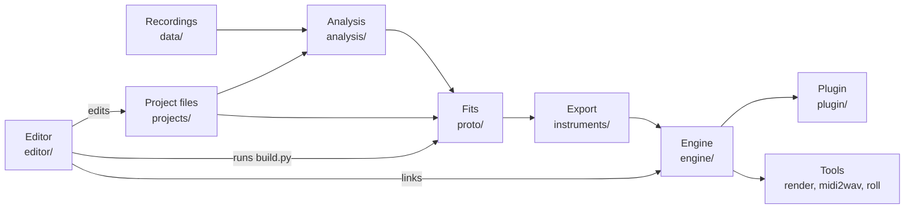

# Architecture

How the system works today, layer by layer. Why it came to be this way, with the measured
numbers, is in the [design log](log/README.md); the numbers in brackets below are its steps.

## Instruments

An instrument is a directory under `instruments/` (or any search path of the plugin) holding:

- `instrument.json`: physical parameters, not samples. Per note the strings (frequency,
  inharmonicity, length, tension, mass, unison detuning, losses, bridge coupling) and the
  exciter (hammer, pluck, tangent, finger) or, for bars, tubes and tines, the modes (ratio,
  damping, shape, output weight) and the mallets. Per instrument the soundboard's modes, the
  per-note transfer correction, the dampers, the parameters of the noises (knock or a piano's
  hammer impact, release, pedal, room), the phantom partials' level, the velocity map, the output
  gain, the body (which geometry places the microphones), the registers (each with the stop that plays
  it: a recorded second 8′ sits on the 8′ II's), the recorded range and
  the menu entry (`[menu]` in the project: name, group, labels, the strip's key colors).
- `data.bin`: the arrays the JSON points into (little-endian), among them the two fitted radiation
  responses (the recording's fine structure), the board's modes and the per-note correction.
- `level.json`: the engine's measured ff level, for morphing at matched loudness [116]; a piano's
  level over its hammer speed on every key, which maps its velocity [124].
- `LICENSE.md`: the instrument's license (CC BY 4.0, or CC BY-SA 4.0 where a ShareAlike set is
  reached through `[uses]`) and the credit of every set it was fitted from (`proto/license.py`).

An instrument is about 0.7 MB (0.4–1.2 MB). The engine derives everything else at load [6]. The
engine's report on an instrument (`engine/src/info.rs`) says what it has: its body, exciter, stops,
mallets, range, the preparations that act and the controls without effect. The rules run over the
data, never over a name [77]. The plugin shows exactly what that report allows.

## Making an instrument

Every instrument is a project, `projects/<name>/project.toml`: its sample sets and how their
files map to notes and dynamics, its scale model, its fits' settings, what it borrows from other
projects (`[uses]`), its export options and its menu entry, each with the reason as a comment
[76]. No instrument is named in the code; a test enforces it.

A project's family picks its chain of steps (`projects/steps.toml`): `struck` (pianos),
`plucked` (harpsichords), `tangent` (clavichord), `fingered` (harps, zithers), `guitar`, `bars`,
`rolled`, and a few special ones. `proto/build.py` runs a chain, the projects it borrows from
first (a lender built elsewhere or without its recordings is taken as committed: what it lends is in
git). Each step declares what it reads and writes; `analysis/project.py` refuses any other
access, and `ledger.json` keeps a fingerprint of every declared read, so `status` names what
went stale and why [76, 107]. The steps fall into four kinds:

- **Analysis** (`analysis/`): partial frequencies, inharmonicity, decays and tuning per take
  (`analyze.py`); bars' modes by peak picking (`modes.py`); the noises and decays between the
  partials: release, dampers, pedal, body, attack (`release_noise.py`, `damper_decay.py`,
  `pedal_noise.py`, `body_decay.py`, `attack_noise.py`); runs split into notes (`split_runs.py`).
- **Fits** (`proto/`): each one fits the prototype's model to the analysis.
  - the hammer felt and the hammer speeds per dynamic;
  - the soundboard: the transfer H, a synthetic modal board, and a radiation draw that puts no
    fundamental in a notch [55]; its per-note correction, where a project asks, also from the
    recordings' attack in bands above the tracked partials [133]; on the pianos the export rings the
    board's low modes longer (`[board] low_eta`), radiated to both microphones in phase [184];
  - the string losses and the unison coupling, then on the pianos the horizontal polarization's
    level along the keyboard, to the aftersound's level [127]; where a project asks, the strings'
    high-frequency loss (β3 and the loss law's exponent q) to the partials up to the 60th [132];
    the unison's detune toward the top key from the recordings' beats there (`[unison] treble`,
    measured by `unison_check.py`) [183];
  - the pianos' room cut where the strings' onset drives it past the sound between the recorded
    partials [123];
  - the register gain;
  - the knock (a piano's: the hammer's impact on the board [126]), the fine structure and the pedal
    ring;
  - for plucked strings, the pluck point and the polarizations [36];
  - measured body modes [49];
  - for bars, the modes, mallets and harmonics [40–45]; a mallet's lowpass cuts a bar's
    fundamental at mf by at most 3 dB [191].
- **Export** (`proto/export.py`, `proto/export_bars.py`): writes `instruments/<name>/`.
- **Roll** (`engine/src/roll`, the `roll` binary): a rolled piano is made from other pianos'
  exports instead of recordings. Its strings are blended from three grands, its body comes from
  two knobs measured on the real pianos' responses, and a realism check tests the result
  [117, 118].

The Python prototype is the reference the engine is checked against. The engine plays the
prototype's renders to about −70 dB.

## The engine

`engine/` is Rust (edition 2024): a library with a C ABI (`plugin/src/pianoengine.h`) and the
tools `render`, `bench`, `midi2wav`, `level` and `roll`.

**Loading** has two stages, decode and build. The physics compiler (`physics.rs`) derives from
the file:

- the partials, from f0 and B, their loss b1 + b3·ω_ref²·(ω/ω_ref)^q [132], and the bridge
  admittance, from the board's modes;
- the coupled unison modes, as an eigen-decomposition per key;
- the sympathetic resonators.

The knock, the release bursts and the room are synthesized from their parameters (`noise.rs`). A
piano has no knock but the hammer's impact on the board: each strike's felt force, lowpassed and
scaled (per key by the project's trim by ear [128]), joins its strings' bridge force in the voice,
through the board and the room [126].
The room's own level per band (`eq_db`, the pianos' cuts) sits on top of its unit energy; the
partials get back what a cut takes from them through the per-note correction, and the other
microphone positions match the board's level against the room before its cuts [123].
A morph between instruments works between decode and build, on the parameters [115].

**Voices**: one per key, not per note-on. A re-strike acts on the string still vibrating, its
contact started from rest and added to the running modes. With Live re-strike (the Touch tab, off
by default) its felt meets the ringing strings where they are: during the contact the voice
follows the running modes and reads each string's displacement at the strike point (the unison's
eigenvectors over the bridge weights), the felt's compression measured against it; the contact's
result is added to the running modes as from rest [170]. With it a bar's mallet meets the swinging
bar: the voice follows the bar's modes at the strike point, finds where the mallet meets the surface
(relative speed u = v − ẏ) and splits the collision's change of the surface velocity, c·u with
c = (1 + e)·m / (m + M), into a brake on the running modes (c of their velocity there) and today's
strike at the mallet's speed, as bright as one at u [171].

- Strings and modes are complex one-poles in float32, 16 per SIMD lane group (AVX2+FMA when
  available). The exact state is kept in double precision and re-synchronized every 64 samples
  and before every event.
- A mode quieter than −80 dB at the strike is not started, and a running mode below −100 dB is
  dropped [2].
- The exciter: a hammer's contact runs in the audio thread, with sub-steps for stiff treble felt
  [28]; where a part's `[felt_core]` sets one, the felt has a stiff core under its soft layer,
  K_c·max(δ − d_c, 0)^p on top of K·δ^p, set by ear and read by the export only [134]. The player's
  felt (the Felt tab, `felt.rs`) bends each key's felt at the build; the level table and each key's
  ff level are measured again (`Instrument::with_felt_edit`) and each key's level shifted back, so
  only the tone changes; Hammer hardness on a hammer piano goes the same way [145]. A pluck, a tangent or a mallet starts the modes from their starting amplitudes [18, 40].
  A mode may rise from zero over the mallet's contact [67].

**Dampers and pedals**: each key has a damper engagement from 0 (lifted) to 1 (resting).

- The sustain pedal moves it continuously, so half-pedaling works [5]. A lift kicks the strings
  from rest [51].
- Sostenuto and the soft pedal act on the keys, una corda on a grand and the hammer rail on an
  upright.
- The release velocity sets the damper's fall.

**Sympathetic resonance**: one bank of resonators over every free string, driven by the summed
bridge force. Its drive fades over 20 ms as dampers land or lift [75]. The plugin's audio input
drives the same bank [94].

**Radiation**: each note drives the board at its bridge point, mixed between eight zones [11].

- At the Recording position the fitted responses play as they are.
- Every other position re-synthesizes them from the board's modes along each microphone's paths:
  direct, floor, lid and wall, with the board's directivity and air absorption [10–16]. A bounded
  reflector (a lid) reflects from its size up, a 6 dB/octave highpass by Rindel's estimate; the
  pair's two channels sit at the fitted channels' mean level, the right one's radiation independent
  of the left's at its size and coherent with it by the spacing [187].
- `mic::Body` holds each instrument kind's geometry: grand, upright, harps, guitars, zithers, the
  bars' frames, the crotales' bar, the tubes' racks, the kalimba. The geometry places and clamps
  the microphones and draws them in the UI, so the drawing cannot disagree with the sound [21].
- The lid and the pillow filter the paths [`mic.rs`, `pillow.rs`]; a lid taken off (lid above 1,
  `LID_OFF`) leaves the reflectors and the filters out [188].
- The board's bass (`board_bass.rs`, Bass on a hammer piano) is a gain on the strings below
  180 Hz, a fixed shape added to their per-note correction at the compile; not on the body
  responses, which carry the strike's thud as well (there it popped under the higher notes). It
  rebuilds no response [148].
- Non-uniformly partitioned convolution in float32 plays the body and the room. The latency is
  64 samples.

**Rebuilds**: tuning, temperament, stretch, wear, the felt, the board's bass and microphone setups
are compiled into the strings and the responses. A change builds a new engine on the plugin's
worker.

- The new engine takes over the old one's sounding notes and their exact state, so the notes
  glide to the new tuning, and the radiation crossfades [13]. Strings compiled alike (a
  microphone moved) go over whole; new responses take the old ones' input history and crossfade
  at the outputs over 30 ms, where the old ones rang out their tails [159].
- A cache keeps the last six microphone setups; a switch back takes about 12 ms [113].
- Another instrument, or another mix of instruments, fades the old engine out over 30 ms beside
  the new one [116].

**Expression and character**: these are live parameters or compiled options of one engine:

- the condition (a wear macro) and the defects [7–9]. The Condition's zones (`EngineValues.cpp`)
  end at 10 % (Normal, the default: the keys' uneven voicing alone), 35 % (Worn: the other aspects
  begin) and 100 % (Broken); 0 % (Mint) is the export as it is [195]. The wear acts by the kind of
  instrument: `Wear::on` gives bars, discs, tubes and tines no soundboard, strings or false beats
  to wear, metal ones keep their pitch and wooden bars drift a little [192]; a plucked string's
  soundboard wears a third of a struck one's [193]; `LiveWear::of` lets the keys of bars and of
  strings played by hand differ in level alone, by half a piano's, and gives hand-played strings
  no hammer wear [194]. The phantom partials are part of a piano's
  own sound in the bass (its export's level), the Phantom partials defect adds to them; both
  play in full up to C2 and fade out by C3 [131, 190];
- the preparations;
- the temperaments and "As recorded" [19, 73];
- the stretch;
- the Bebung and the pitch wheel [56, 62];
- the vibraphone's motor [41];
- the membranes' buzz and rattle [60, 70];
- the velocity curve [110], then on the pianos the Dynamics: each key struck at the speed at which
  its level table (`level.json`) gives one curve over the velocity, its range the control [124].

**Real-time rules**: the audio thread never allocates, blocks or frees (`engine/tests/realtime.rs`
counts it). The engine sets flush-to-zero itself. Panic fades out over 20 ms and leaves exact
silence [52]. Two guards against a runaway [172]: a voice whose mode state passes 30 dB over the
largest strike it got since it was last silent (or is not finite) is silenced at the block's end; a
sample past +20 dBFS (× the Volume above 0 dB; or not finite) clears every sound at once. Both are counted (`Stats::runaways`). A build beside it shares the memory: the audio thread at a microphone position
misses the L3 cache by design, so a build that writes much memory slows its blocks (IPC 3.1 →
0.8); engines share the instrument's noise bursts, a measuring engine's responses end with its
window, and the plugin's builds take the physical cores but one (`threads.rs`) [149]. The output is
calibrated so that the median ff note peaks at −15 dBFS, with an output gain per instrument
(`output_gain_db`, the project's `[export]`) that puts a phrase in its middle register at the grands'
loudness, ±1 dB (EBU R128) [173].

**Cost**: about 12 % of one laptop core (Ryzen 7 7840HS) for a heavily pedaled ff passage of
88 voices at the Recording position. The other positions cost more, about 16 % at a close one
[16]. Building an engine takes 0.1 s at a microphone position and ~20 ms for a tuning change.

## The plugin

`plugin/` is a DPF wrapper in C++17: LV2 and the JACK standalone are the targets; CLAP and VST3
are built but untested.

- **Parameters**: `Params.hpp` is the interface (indices, symbols, ranges, descriptions). One
  mapping from parameters to the engine's values (`EngineValues`) serves the DSP, the UI and
  Copy CLI's `midi2wav` line [53].
- **Instruments**: the catalog (`Catalog.*`) lists every instrument directory in the search
  paths. The choice is the `instrument` state, saved by name [77], or by its path for a folder
  opened from the menu [163]. A file watch reloads an instrument whose files change, such as a
  re-export or the editor's rolled preview.
- **Threads**: a worker builds engines and hands them to the audio thread through single-writer
  atomic slots; it runs at nice 10, its builds on the physical cores but one
  (`pe_set_build_threads`). The audio thread swaps them and calls `adopt`. The UI and the DSP talk through
  parameters and a shared telemetry region: notes, the velocity history, values set by MIDI, and
  while a bottom panel is open, 30 frames a second of the voices' partials and each key's strings,
  damper and last strike (the Analysis and Visualization panels).
- **State**: `instrument`, `velocity_curve`, `morph` (the partners), `felt` (the player's bends),
  `scale_file` (the Scala file's path), and `ui` (the tab, the zoom, the bottom panel).
  MIDI learn's ties live outside the session in `~/.config/pianoengine/midi-map.txt` [111].
- **UI** (`src/ui/`, NanoVG): the layout, formatting and capabilities are pure logic in
  `pe_common`, tested by `plugin/tests/ui_tests.cpp`. The header carries the instrument, the
  stops, the motor, the sustain latch, Volume, Panic and the menu (zoom, Copy CLI, Reset). The
  microphone drawing comes from the engine's geometry. Nine tabs hold the rest (Sound, Morph,
  Touch, Felt, Mics, Tuning, Condition, Extras, MIDI) [47].

## The editor

`editor/` is Rust with egui. It works over the project files and `proto/build.py`, and links the
engine.

- **Model**: the pages edit `rule.rs`, a model of a source's mapping rule, never TOML directly.
  `toml_edit` rewrites only the changed keys, and a committed source read and applied back is
  unchanged [80].
- **Mapper**: `mapping.rs`, `sfz.rs` and `suggest.rs` give the same items as
  `analysis/mapping.py`; a parity test holds them together [79].
- **Pages**:
  - the wizard (New instrument…, and Add a source… on a project: folder, reading, names,
    dynamics, how it is played, check, name and menu) [80, 86];
  - a source's tabs;
  - the project page;
  - the build page (a client of `build.py --json`);
  - Compare (every recording against the engine's render of it) [95–100];
  - Correct levels [98, 103];
  - the take checks [105];
  - New rolled piano… [117, 118].

## How the layers check each other

- Every exported instrument against renders: the engine's report must equal what the renders
  measure (`engine/tests/no_effect.rs`). `level.json` must match the engine within 0.1 dB, its
  level table within 0.2 dB (`engine/tests/level_files.rs`).
- The plugin's UI per instrument, position and preparation is recorded in
  `plugin/tests/visibility.txt` (`PE_WRITE_UI_TABLE=1` rewrites it; read its diff).
- The editor's mapper against Python's, the rule model and the suggestion against every committed
  source, and Compare's and the take checks' flags under ceilings.
- `proto/tests`: the prototype, the exports, the radiation's notches, borrowed reads, and that no
  code names an instrument.

`just test` runs all four suites. They test each other's data, so a change is done only when all
four pass.
